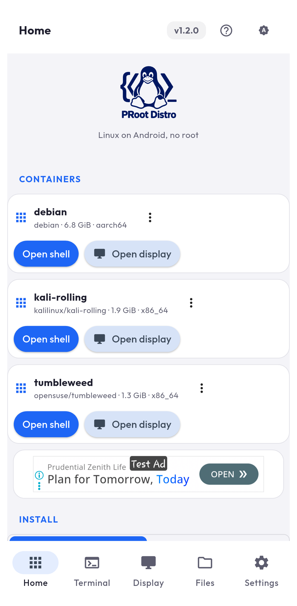
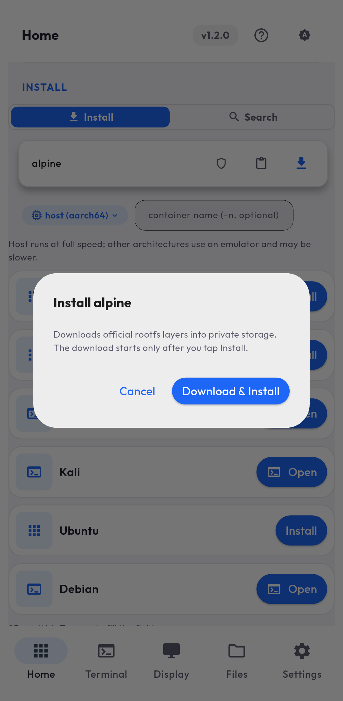
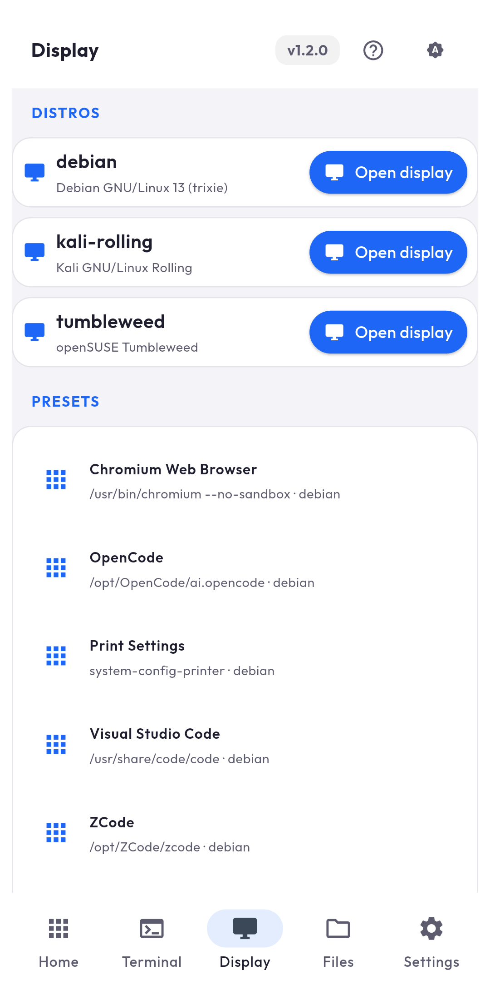
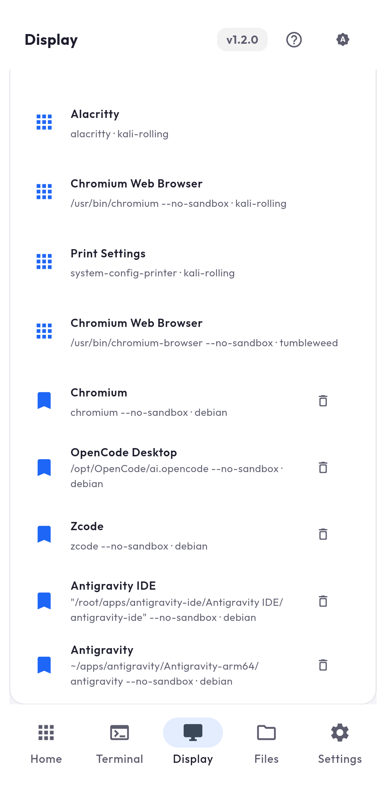
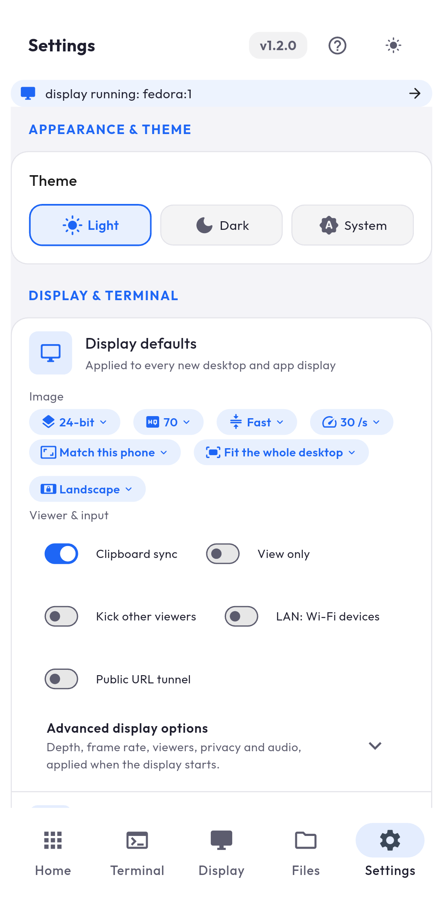
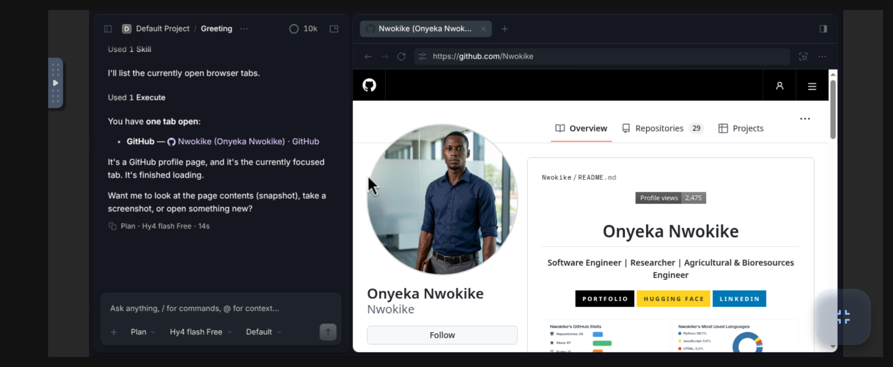
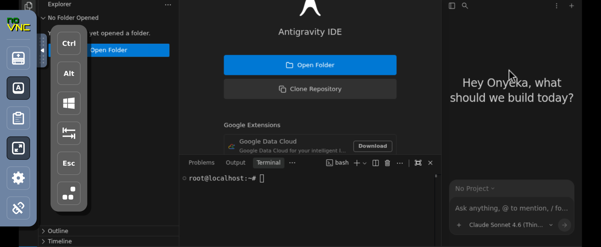
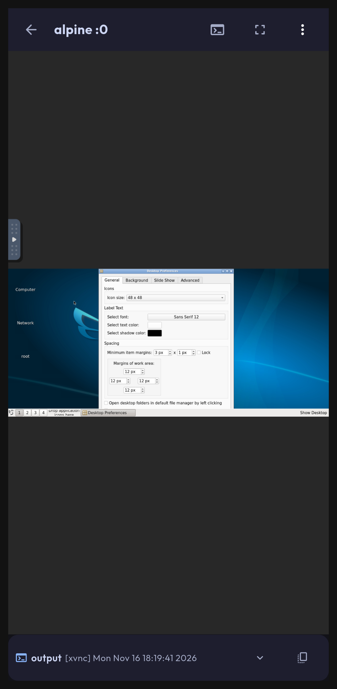
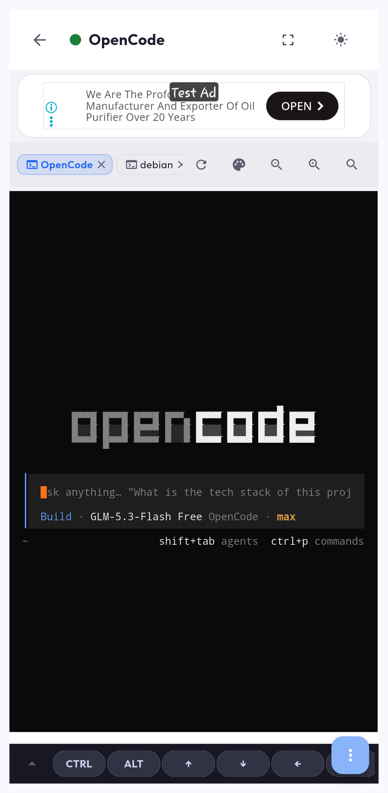
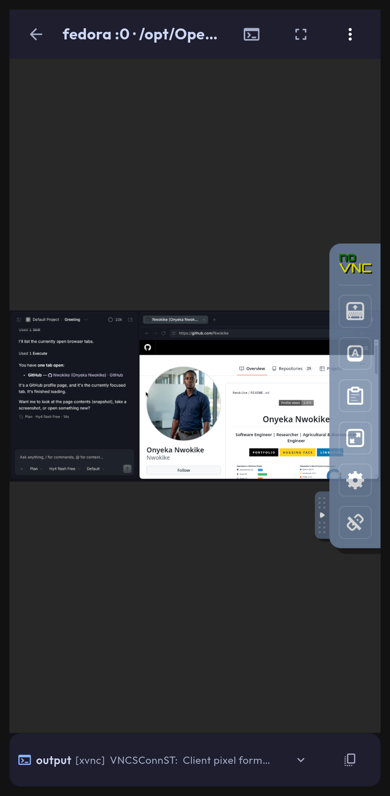

<p align="center">
  
</p>

<p align="center">
  <b>Linux on Android, no root.</b><br/>
  Real Debian, Ubuntu, Alpine, Fedora, Arch, Kali and openSUSE containers,
  a real X11 desktop, and GUI apps like VS Code, Chromium, Antigravity, ZCode and OpenCode.
</p>

<p align="center">
  <a href="https://play.google.com/store/apps/details?id=ng.kiri.prootdistro"></a>
  <a href="https://github.com/Nwokike/proot-distro/releases/latest"></a>
  
  
</p>

---

## Download

| Platform | Download |
| :---: | :--- |
| 🤖 **Google Play** | [Install from the Play Store](https://play.google.com/store/apps/details?id=ng.kiri.prootdistro) |
| 📦 **APK, ARM64** | [proot-distro-x11-arm64-v8a.apk](https://github.com/Nwokike/proot-distro/releases/latest/download/proot-distro-x11-arm64-v8a.apk) |
| 💻 **APK, x86_64** | [proot-distro-x11-x86_64.apk](https://github.com/Nwokike/proot-distro/releases/latest/download/proot-distro-x11-x86_64.apk) |

Android 8.0 and newer, ARM64 or x86_64. Tap any screenshot to open it full size.

---

## Linux containers on Android, no root and no Termux

Install any Docker image (Debian, Ubuntu, Alpine, Fedora, Arch Linux, Kali, openSUSE, and more), open a shell, or run a command on its own display. No root, no system modification, no separate terminal app.

| | | | |
| :---: | :---: | :---: | :---: |
| [](screenshots/home_light.png) | [](screenshots/home_dark.png) | [](screenshots/install_confirm_light.png) | [](screenshots/install_progress_light.png) |
| Containers and installs | Dark theme, display running | Install confirmation | Live install log |
| [](screenshots/search_results_light.png) | [](screenshots/display_tab_light.png) | [](screenshots/presets_light.png) | [](screenshots/settings_light.png) |
| Docker Hub search | Distros and detected apps | Saved presets | Display and terminal defaults |

## Run any Linux GUI app on Android

Any X11 command runs on its own display. Apps installed inside a container are detected automatically as one-tap presets, with a `--no-sandbox` checkbox for Chromium and Electron. Save your own commands with their work dir and env.

| | |
| :---: | :---: |
| [](screenshots/opencode_browser_wide.png) | [](screenshots/zcode_app.png) |
| OpenCode answering a question about the browser tab open next to it | ZCode running inside the viewer |

## Desktop apps on Android: VS Code, Antigravity, ZCode, Chromium

Full desktop applications run for real, not as demos.

| | | |
| :---: | :---: | :---: |
| [](screenshots/vscode_marketplace.png) | [](screenshots/antigravity_ide_landscape.png) | [](screenshots/desktop_session.png) |
| VS Code with Marketplace and Copilot | Google Antigravity IDE | A complete X11 desktop session |

Chromium, Brave and Electron apps need `--no-sandbox` under proot; the detected preset adds it with one checkbox.

## Linux terminal on Android

A real PTY, not a command runner: sticky CTRL and ALT, extra keys, search, zoom, and four themes. The default theme follows the app mode, Dracula in dark and Colab Light in light.

| | |
| :---: | :---: |
| [](screenshots/terminal_alpine_light.png) | [](screenshots/terminal_opencode_light.png) |
| Alpine shell | Installing OpenCode in a shell |

## X11 desktop and VNC viewer on Android

Xvnc and PulseAudio run inside the app, so a container needs nothing installed. The viewer is upstream noVNC, verbatim: its panel gives you the on-screen keyboard, CTRL, ALT, ESC and extra keys, and its settings cover scaling and reconnects. Under it, the output panel streams the guest log.

| |
| :---: |
| [](screenshots/opencode_browser_portrait.png) |
| OpenCode and a browser, with the noVNC panel and the output panel open |

Gestures: one finger drags the mouse, two fingers scroll, pinch zooms. The sheet reminds you, and the first viewer shows it once.

## Microphone and audio

The mic is off at display start. The toolbar button is the only switch, and it asks Android for the recording permission when you turn it on.

| |
| :---: |
| [](screenshots/mic_voice_chat.png) |
| Microphone on: a voice chat with Antigravity |

## File manager and backups on Android

Browse the container filesystem, preview text, images and binary files (type and size, no garbage), run a file in place with its output streamed, or start it in a display or a terminal (all from the file's own folder), upload, download, zip, copy and sync with checksum verification. Back up and restore a container in any tar format.

| |
| :---: |
| [](screenshots/files_browser_light.png) |
| Container file browser |

---

## Also built in

- **Multiple displays at once**: sessions are keyed `container:display`, so several apps and several containers run side by side.
- **Cross-architecture images**: aarch64, arm, i686, x86_64 and riscv64, with QEMU user-mode bundled in the APK.
- **Background running**: a foreground service keeps shells and displays alive while you use other apps, with an Exit action.
- **Shell with options**: every `pd login` flag, from users read out of the container's `/etc/passwd` to work dir, env, binds, shared tmp/home, isolation and low ports.
- **Start X display in your shell**: one tap exports `DISPLAY` and `XAUTHORITY`, so `firefox` typed in that shell opens in the viewer.
- **LAN and tunnel sharing**: open the display to Wi-Fi devices or a public `*.lhr.life` URL, always behind the access code.
- **Docker Hub search and OCI installs**: search with a result limit, or type a full reference; choose an architecture, a custom name or an insecure registry.
- **Storage and cache**: containers and the OCI cache are measured separately, with sweep, build cache and app cache actions.
- **Build and push**: build a Dockerfile into an OCI image and push it to a registry from Settings, Developer tools.

---

## Display options

Every control maps to a real Xvnc or PulseAudio setting.

| Area | Options |
| :--- | :--- |
| **Image** | Depth, quality, compression, frame rate, resolution, fit, orientation |
| **Viewer** | Clipboard sync, view only, kick other viewers, LAN, public tunnel, access code |
| **Xvnc** | Shared or single viewer, pixel diff, DPI, idle and session timeouts, auto-close, clipboard cap |
| **Audio** | Playback and mic, AAudio mode, latency, rates, format, channels, resampler, guest notifications |
| **Viewer extras** | Bell, cursor dot, viewer log level |
| **Login** | User, work dir, env, binds, shared tmp/home, isolated, low ports, hostname, kernel, emulator |
| **Session** | Display number, defaults to the next free one |

The same options live in Settings, so every new display starts with your choices.

---

## Requirements and limits

- **X11 only.** Xvnc is an X11 server, so Wayland-only apps cannot render.
- **Desktops are commands.** There is no desktop installer: install the packages in the container, then run its session command (for example `startxfce4`).
- **Emulated containers are slower.** Chromium and Electron can trap under QEMU; prefer a container matching the phone's architecture.
- **The public tunnel needs `ssh`** inside the container.

---

## Architecture

| Layer | Technology |
| :--- | :--- |
| UI | Flet 1.1.2 |
| Containers | `proot-distro` (proot based, no root) |
| Sessions | In-app PTY service |
| Display | Xvnc, PulseAudio, aiohttp, noVNC |
| Emulation | QEMU user-mode |
| Storage | App-private files |

Xvnc and PulseAudio run **inside the app**, so a container needs nothing installed for a display. The guest reaches them over shared loopback.

---

## Privacy

No accounts, no telemetry. Container data stays in app-private storage. The display binds loopback unless you enable LAN or the tunnel. Every viewer is gated by a per-session access code. `proot` is userspace only: no root, no system modification.

---

## Building

```bash
uv sync
uv run flet run
```

Android builds run in GitHub Actions. See [docs/release.md](docs/release.md) and [docs/architecture.md](docs/architecture.md).

---

## License

PRoot (GPL-2.0-or-later), proot-distro (GPL-3.0-only), talloc (GPL-3.0-or-later), Xvnc (GPL-2.0-or-later), PulseAudio (GPL-2.0-or-later), noVNC (MPL-2.0), QEMU (GPL-2.0) and Flet (Apache-2.0). Corresponding source is available in this repository. Full license texts ship in `LICENSES/` and in **Settings → About → Open-source licenses**.

Proot Distro X11 is an independent, unofficial client. It is not affiliated with the Termux project, the proot-distro project, or any Linux distribution. Linux is a trademark of Linus Torvalds.
