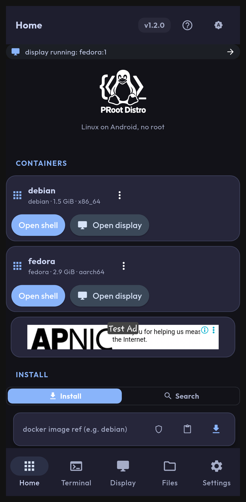
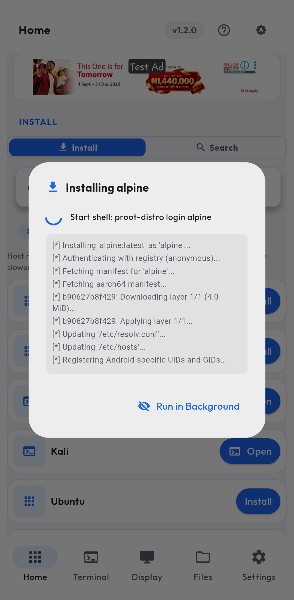
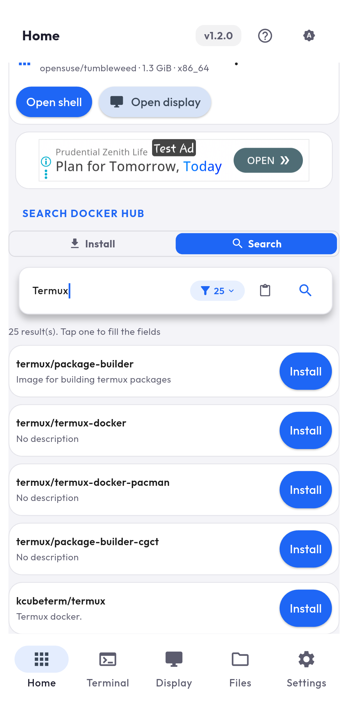
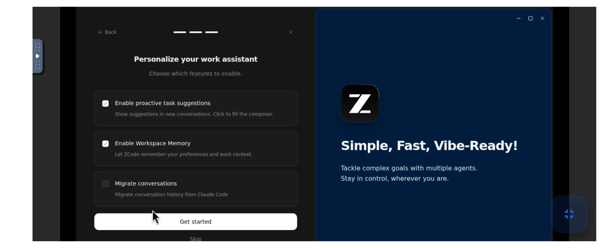
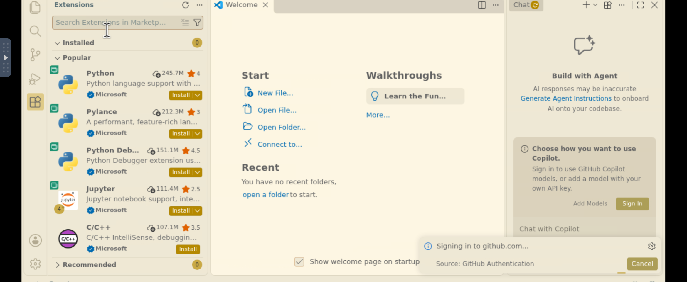
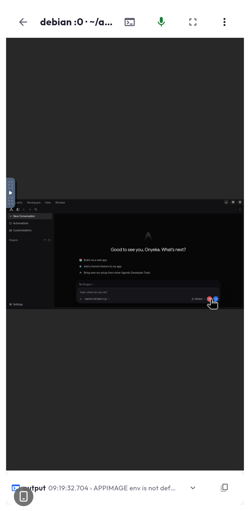
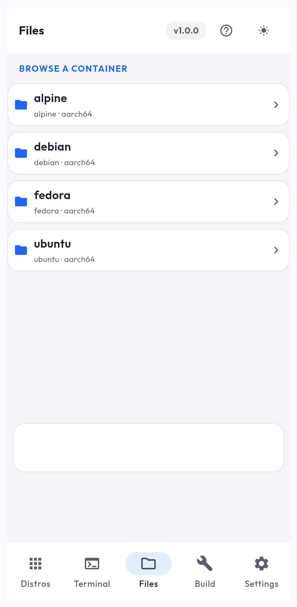

<a id="top"></a>

<div align="center">
  

  <p>
    <b>Linux on Android, no root.</b><br/>
    Real Debian, Ubuntu, Alpine, Fedora, Arch, Kali, openSUSE, or any public containers,
    a real X11 desktop, for GUI apps.
  </p>

  <p>
    <a href="https://play.google.com/store/apps/details?id=ng.kiri.prootdistro"></a>
    <a href="https://github.com/Nwokike/proot-distro/releases/latest"></a>
    
    
  </p>

  <p>
    <a href="#download">Download</a> •
    <a href="#the-app">Screenshots</a> •
    <a href="#desktop-apps-on-android-vs-code-antigravity-chromium">Desktop Apps</a> •
    <a href="#display-options">Display Options</a> •
    <a href="#architecture">Architecture</a> •
    <a href="#building">Building</a>
  </p>
</div>

---

## Download

| Platform | Download |
| :---: | :--- |
| 🤖 **Google Play** | [Install from the Play Store](https://play.google.com/store/apps/details?id=ng.kiri.prootdistro) |
| 📦 **APK, ARM64** | [proot-distro-x11-arm64-v8a.apk](https://github.com/Nwokike/proot-distro/releases/latest/download/proot-distro-x11-arm64-v8a.apk) |
| 💻 **APK, x86_64** | [proot-distro-x11-x86_64.apk](https://github.com/Nwokike/proot-distro/releases/latest/download/proot-distro-x11-x86_64.apk) |

Android 8.0 and newer, ARM64 or x86_64.

---

## The app

<table>
  <tr>
    <td width="50%"><a href="screenshots/home_light.png"></a></td>
    <td width="50%"><a href="screenshots/home_dark.png"></a></td>
  </tr>
  <tr>
    <td width="50%"><a href="screenshots/install_confirm_light.png"></a></td>
    <td width="50%"><a href="screenshots/install_progress_light.png"></a></td>
  </tr>
  <tr>
    <td width="50%"><a href="screenshots/search_results_light.png"></a></td>
    <td width="50%"><a href="screenshots/display_tab_light.png"></a></td>
  </tr>
  <tr>
    <td width="50%"><a href="screenshots/presets_light.png"></a></td>
    <td width="50%"><a href="screenshots/settings_light.png"></a></td>
  </tr>
</table>

## Linux containers on Android, no root and no Termux

Install any Docker image: Debian, Ubuntu, Alpine, Fedora, Arch Linux, Kali, openSUSE
or any public reference. Open a shell, or run a command on its own display. No root,
no system modification, no separate terminal app. Full references, custom container
names, target architectures and insecure registries are all supported.

## Run any Linux GUI app on Android

Any X11 command runs on its own display. Apps installed inside a container are
detected automatically as one-tap presets, with a `--no-sandbox` checkbox required for Electron apps to run on PRoot-Distro. Save your own commands with their work dir and env.

<table>
  <tr>
    <td width="50%" align="center">
      <a href="screenshots/opencode_browser_wide.png"></a><br/>
      <sub>OpenCode answering a question about the browser tab open next to it</sub>
    </td>
    <td width="50%" align="center">
      <a href="screenshots/zcode_app.png"></a><br/>
      <sub>ZCode running inside the viewer</sub>
    </td>
  </tr>
</table>

## Desktop apps on Android: VS Code, Antigravity, Chromium

Full desktop applications run for real.
Electron apps need `--no-sandbox` under proot; the detected preset adds it with
one checkbox.

<table>
  <tr>
    <td width="50%" align="center">
      <a href="screenshots/vscode_marketplace.png"></a><br/>
      <sub>VS Code with Marketplace and Copilot</sub>
    </td>
    <td width="50%" align="center">
      <a href="screenshots/antigravity_ide_landscape.png"></a><br/>
      <sub>Google Antigravity IDE, full IDE in landscape</sub>
    </td>
  </tr>
</table>

<table>
  <tr>
    <td align="center">
      <a href="screenshots/desktop_session.png"></a>
    </td>
  </tr>
  <tr>
    <td>
      <b>A complete desktop is a command.</b><br/><br/>
      No desktop installer needed: install the desktop packages in the container, then run its session command such as <code>startxfce4</code> or <code>mate-session</code> from the display sheet. This is LXQt with its panel, a file manager and desktop settings.
    </td>
  </tr>
</table>

## Linux terminal on Android

A real PTY, not a command runner: sticky <kbd>CTRL</kbd> and <kbd>ALT</kbd>, extra keys, search, zoom,
and four themes. The default theme follows the app mode, Dracula in dark and
Colab Light in light.

<table>
  <tr>
    <td width="50%" align="center">
      <a href="screenshots/terminal_alpine_light.png"></a><br/>
      <sub>Alpine shell installing OpenCode</sub>
    </td>
    <td width="50%" align="center">
      <a href="screenshots/terminal_opencode_light.png"></a><br/>
      <sub>Running OpenCode in the same shell</sub>
    </td>
  </tr>
</table>

## X11 desktop and VNC viewer on Android

Xvnc and PulseAudio run inside the app, so a container needs nothing installed.
The viewer is upstream noVNC, verbatim: its panel gives you the on-screen
keyboard, <kbd>CTRL</kbd>, <kbd>ALT</kbd>, <kbd>ESC</kbd> and extra keys, and its settings cover scaling and
reconnects. Under it, the output panel streams the guest log.

<table>
  <tr>
    <td align="center">
      <a href="screenshots/opencode_browser_portrait.png"></a>
    </td>
  </tr>
  <tr>
    <td>
      <b>Real gestures, real keyboard.</b><br/><br/>
      One finger drags the mouse, two fingers scroll, pinch zooms. The keyboard opens through the noVNC panel. The output panel below the viewer shows the guest log, with a Copy button so a failure can be reported.
    </td>
  </tr>
</table>

## Microphone and audio on Android

Audio out and the microphone both run inside the app through PulseAudio, so guest
apps play sound with nothing installed. The microphone is off at display start:
the toolbar button is the only switch, and it asks Android for the recording
permission the moment you turn it on. Playback is unaffected by the mic state.

The audio surface is real: AAudio performance mode, latency, speaker rate, mic
rate, mic format, mic channels and the PulseAudio resampler are all in Display
options.

<table>
  <tr>
    <td align="center">
      <a href="screenshots/mic_voice_chat.png"></a>
    </td>
  </tr>
  <tr>
    <td>
      <b>Microphone on demand.</b><br/><br/>
      The green mic in the toolbar means the microphone is live. Tap it again to turn it off without leaving the viewer. This is a voice chat with Antigravity, with the mic on.
    </td>
  </tr>
</table>

## File manager and backups on Android

Browse the container filesystem, preview text, images and binary files (type and
size, no garbage), run a file in place with its output streamed, or start it in a
display or a terminal (all from the file's own folder), upload, download, zip,
copy and sync with checksum verification. Back up and restore a container in any
tar format.

<table>
  <tr>
    <td align="center">
      <a href="screenshots/files_browser_light.png"></a>
    </td>
  </tr>
  <tr>
    <td>
      <b>Preview, run, move.</b><br/><br/>
      Tap a file to preview it. Text files open in a monospace view, images inline, binaries as a type and size card. Run, Display and Terminal start it with the file's folder as the working directory.
    </td>
  </tr>
</table>

---

## Also built in

- **Multiple displays at once**: sessions are keyed `container:display`, so several apps and several containers run side by side.
- **Cross-architecture images**: aarch64, arm, i686, x86_64 and riscv64, with QEMU user-mode bundled in the APK.
- **Background running**: a foreground service keeps shells and displays alive while you use other apps, with an Exit action.
- **Shell with options**: every `pd login` flag, from users read out of the container's `/etc/passwd` to work dir, env, binds, shared tmp/home, isolation and low ports.
- **Start X display in your shell**: one tap exports `DISPLAY` and `XAUTHORITY`, so `firefox` typed in that shell opens in the viewer.
- **LAN and tunnel sharing**: open the display to Wi-Fi devices or a public `*.lhr.life` URL, always behind the access code, with a sign-in page for the code. The tunnel runs `ssh` inside the container, so install openssh in that container.
- **Docker Hub search and OCI installs**: search with a result limit, or type a full reference; choose an architecture, a custom name or an insecure registry.
- **Storage and cache**: containers and the OCI cache are measured separately, with sweep, build cache and app cache actions.
- **Build and push**: build a Dockerfile into an OCI image and push it to a registry from Settings, Developer tools.
- **Guest notifications**: apps inside the display can raise their notifications as native Android ones, best effort.
- **Bundled fonts**: core X fonts plus DejaVu TrueType, exposed to the guest, so Firefox and Electron apps render text without installing anything.
- **Report a problem**: copy the app log or a display log from the app and open GitHub Issues in one tap.

## Display options

| Area | Options |
| :--- | :--- |
| **Image** | Depth, quality, compression, frame rate, resolution, fit, orientation |
| **Viewer** | Clipboard sync, view only, kick other viewers, LAN, public tunnel, access code |
| **Xvnc** | Shared or single viewer, pixel diff, DPI, idle and session timeouts, auto-close, clipboard cap |
| **Audio** | Playback and mic, AAudio mode, latency, rates, format, channels, resampler, guest notifications |
| **Viewer extras** | Bell, cursor dot, viewer log level |
| **Login** | User, work dir, env, binds, shared tmp/home, isolated, low ports, hostname, kernel, emulator |
| **Session** | Display number, defaults to the next free one |

The same options live in Settings, so every new display starts with your choices.

---

## Limits

- **X11 only.** Xvnc is an X11 server, so Wayland-only apps cannot render.
- **Emulated containers are slower.** Prefer a container matching the phone's architecture.

---

## Architecture

| Layer | Technology |
| :--- | :--- |
| UI | Flet 1.1.2 |
| Containers | `proot-distro` (proot based, no root) |
| Sessions | In-app PTY service |
| Display | Xvnc, PulseAudio, aiohttp, noVNC |
| Emulation | QEMU user-mode |
| Storage | App-private files |

Xvnc and PulseAudio run **inside the app**, so a container needs nothing installed for a display. The guest reaches them over shared loopback.

---

## Privacy

No accounts, no telemetry. Container data stays in app-private storage. The display binds loopback unless you enable LAN or the tunnel. Every viewer is gated by a per-session access code. `proot` is userspace only: no root, no system modification.

---

## Building

```bash
uv sync
uv run flet run
```

Android builds run in GitHub Actions. See [docs/release.md](docs/release.md) and [docs/architecture.md](docs/architecture.md).

---

## License

PRoot (GPL-2.0-or-later), proot-distro (GPL-3.0-only), talloc (GPL-3.0-or-later), Xvnc (GPL-2.0-or-later), PulseAudio (GPL-2.0-or-later), noVNC (MPL-2.0), QEMU (GPL-2.0) and Flet (Apache-2.0). Corresponding source is available in this repository. Full license texts ship in `LICENSES/` and in **Settings → About → Open-source licenses**.

Proot Distro X11 is an independent, unofficial client. It is not affiliated with the Termux project, the proot-distro project, or any Linux distribution. Linux is a trademark of Linus Torvalds.
