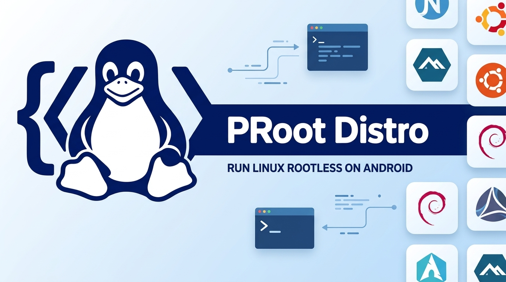
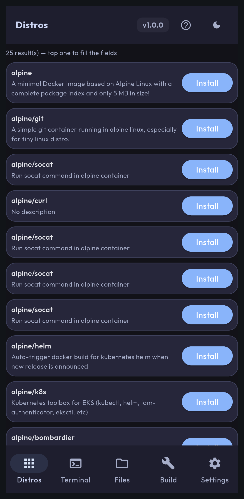
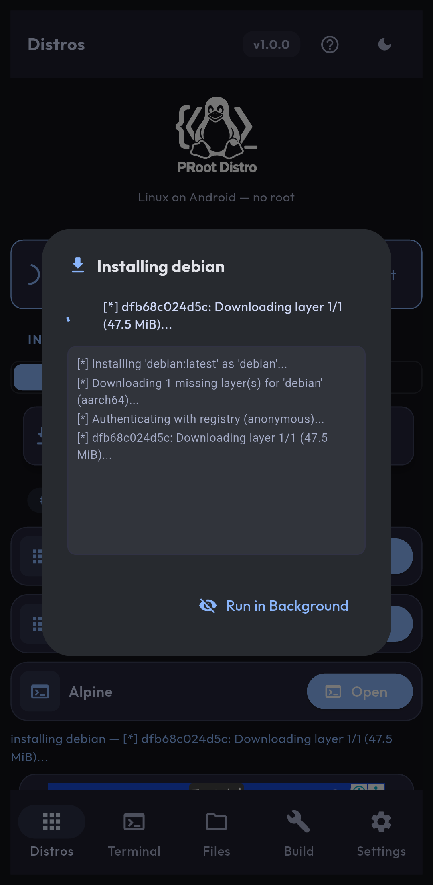
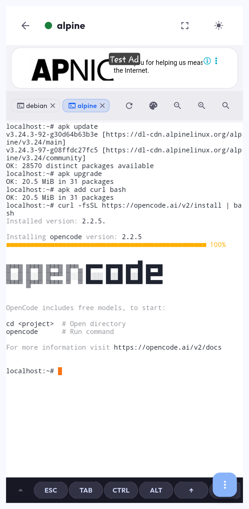
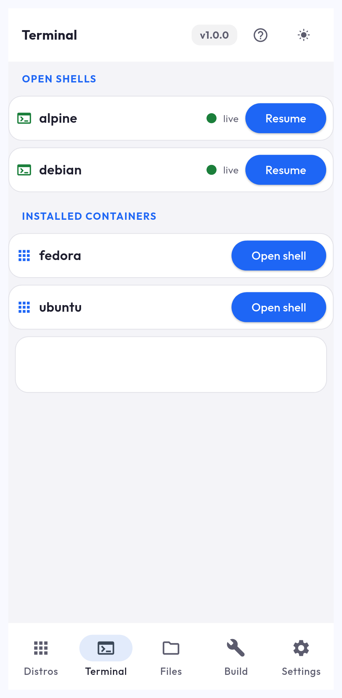
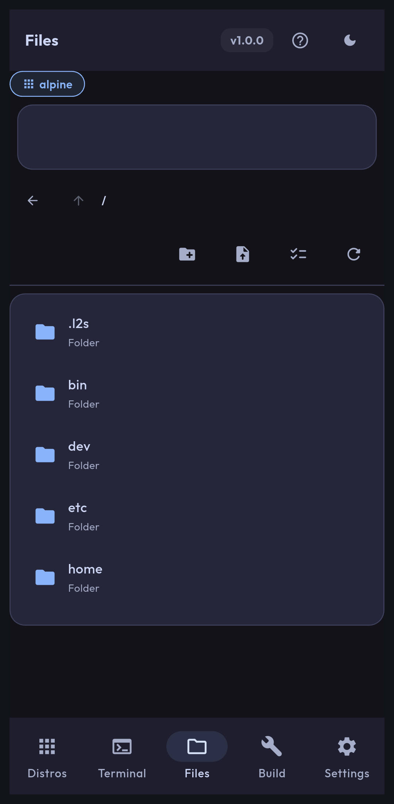
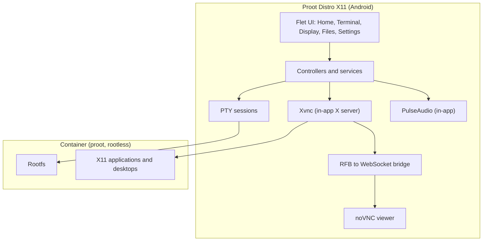

<p align="center">
  
</p>

<p align="center">
  <b>Proot Distro X11</b> runs real Linux containers and a real X11 desktop on Android.
  No root, no Termux, no PC.
</p>

<p align="center">
  <a href="https://play.google.com/store/apps/details?id=ng.kiri.prootdistro"></a>
  <a href="https://github.com/Nwokike/proot-distro/releases/latest"></a>
  
  
</p>

---

## Download

| Platform | Download | Notes |
| :---: | :---: | :--- |
| 🤖 **Android** | [](https://play.google.com/store/apps/details?id=ng.kiri.prootdistro) | Recommended for Android mobile users |
| 📦 **Android (APK)** | [](https://github.com/Nwokike/proot-distro/releases/latest) | Direct APK download for sideloading |

### Android architecture splits

| Variant | Download | Notes |
| :--- | :---: | :--- |
| 📱 **ARM64** (most phones) | [**proot-distro-flet-arm64-v8a.apk**](https://github.com/Nwokike/proot-distro/releases/latest/download/proot-distro-flet-arm64-v8a.apk) | Modern 64-bit Android devices |
| 💻 **x86_64** (emulators) | [**proot-distro-flet-x86_64.apk**](https://github.com/Nwokike/proot-distro/releases/latest/download/proot-distro-flet-x86_64.apk) | Chromebooks and Android emulators |

---

## Core capabilities

| Capability | Description |
| :--- | :--- |
| **Rootless Linux userspace** | Genuine Linux distributions (Debian, Ubuntu, Alpine, Fedora, Arch, Kali, openSUSE and any public Docker image) run through `proot-distro`, with no root and no system changes. |
| **X11 display streamed in the app** | The X server (TigerVNC's Xvnc) and audio (PulseAudio) run **inside the app**, so a single app needs nothing installed in the container. The viewer is upstream noVNC 1.7.0, served verbatim. |
| **Single app on its own display** | Run one program (browser, editor, file manager, a pywebview or Python GUI app, anything on X11) alone on its own `:N` display. |
| **Full desktop sessions** | XFCE, LXQt, MATE, IceWM or Openbox, installed into the container with one editable script, then streamed like any other display. |
| **Multiple displays at once** | Sessions are keyed `container:display`, so several displays per container and several containers can run at the same time, each with a globally unique display number. |
| **Cross-architecture containers** | aarch64, arm, i686, x86_64 and riscv64. QEMU user-mode emulators ship in the APK, so a phone of either ABI can run images of any architecture (emulated images are slower). |
| **Interactive PTY terminal** | Real pseudo-terminal sessions with an extra-keys row, sticky CTRL/ALT, search, zoom, live title tracking, and four terminal themes. |
| **Shell with options** | `pd login` flags exposed one to one: user (read from the container's own `/etc/passwd`), work dir, environment, binds, shared tmp/home, isolated mode, low-port fixing, hostname, kernel release, emulator path. |
| **Start X display in your shell** | Launch a bare display for a container and the shell receives `DISPLAY` and `XAUTHORITY`, so `firefox` typed in that terminal opens on the display. |
| **File manager** | Browse the container filesystem, preview text and images, upload, download, zip a folder, copy and sync paths with checksum verification and prune. |
| **Backup and restore** | Archive a whole container to `.tar.gz`, `.tar.bz2`, `.tar.xz`, `.tar.zst` or plain `.tar`, and restore it anywhere through the native file picker. |
| **Docker Hub search and OCI installs** | Search public images with a result limit, or type a full image reference. Optional custom container name, target architecture and insecure-registry consent. |
| **Background running** | A foreground service keeps shells and displays alive while you use other apps, with a wakelock while a display is in view. |
| **Private by design** | No account, no telemetry. Container data stays in app-private storage, and the display server binds loopback unless you turn on LAN or the tunnel. |

---

## Display options

Every control below maps to a real Xvnc or PulseAudio setting, and the defaults are phone friendly.

| Area | Options |
| :--- | :--- |
| **Image** | Depth 16/24/32, quality 0 to 95, compression 0 to 9, frame rate 1 to 60, resolution (match the phone or a fixed size), fit (scale to fit, remote resize, actual size), full-screen orientation |
| **Viewer** | Clipboard sync, view only, kick other viewers, LAN access, public tunnel (`*.lhr.life`), access-code protection |
| **Xvnc** | Shared or single viewer, pixel-diff mode, DPI, idle timeout, maximum session length, auto-close after disconnect, clipboard size cap |
| **Audio** | Playback and microphone, AAudio performance mode, latency, speaker rate, mic rate, mic format, mic channels, resampler |
| **Viewer extras** | Bell, cursor dot, viewer log level |
| **Login** | User, work dir, env, bind mounts, shared tmp, shared home, isolated, low ports, hostname, kernel release, QEMU emulator |
| **Session** | Display number (`:0` upward, defaults to the next free one) |

The same options live in **Settings → Display defaults**, so every new display starts with your choices.

---

## Requirements and limits

| Item | Detail |
| :--- | :--- |
| Android | 8.0 and newer, ARM64 or x86_64 |
| Storage | A container starts around 100 MB and grows with packages; desktop extras add a few hundred MB |
| Display protocol | **X11 only.** Xvnc is an X11 server, so Wayland-only applications cannot render |
| Public tunnel | Needs `ssh` inside the container; desktop support installs `openssh-client` |
| Desktop packages | Installed with the container's own package manager. Distros without a recognised manager still work: the install cell accepts any command you write |

---

## Screenshots

<table>
  <tr>
    <td width="50%"></td>
    <td width="50%"></td>
  </tr>
  <tr>
    <td width="50%"></td>
    <td width="50%"></td>
  </tr>
  <tr>
    <td width="50%"></td>
    <td width="50%"></td>
  </tr>
  <tr>
    <td width="50%"></td>
    <td width="50%"></td>
  </tr>
</table>

---

## Architecture

| Layer | Technology | Purpose |
| :--- | :--- | :--- |
| **UI** | Flet 1.1.2, declarative components | Android UI, observable state, surgical re-renders |
| **Containers** | `proot-distro` | Image pulls, container lifecycle, login and run commands |
| **Sessions** | In-app PTY service | Interactive shells, command capture, install streams |
| **Display** | Xvnc, PulseAudio, aiohttp, noVNC | X server, audio, RFB to WebSocket bridge, browser viewer |
| **Emulation** | QEMU user-mode | Foreign-architecture containers |
| **Storage** | App-private files | Containers, OCI cache, build cache, exports |



---

## Privacy and security

1. **No accounts, no telemetry.** The app never phones home; the only network calls are the optional update check and the images you install.
2. **Local by default.** Container files live in app-private storage. The display server binds `127.0.0.1` unless you explicitly enable LAN or the tunnel.
3. **Access code on every viewer.** Sharing is gated by a per-session code shown in the app.
4. **No hidden escalation.** `proot` is userspace only: no root, no system modification, no daemon installed on the device.

---

## Building from source

```bash
uv sync
uv run flet run
```

Android builds run in GitHub Actions (`.github/workflows/app.yml`). See
[docs/release.md](docs/release.md) for the release ritual and
[docs/architecture.md](docs/architecture.md) for the design.

---

## License and compliance

Proot Distro X11 incorporates open-source components under free software
licenses, including PRoot (GPL-2.0-or-later), proot-distro (GPL-3.0-only),
talloc (GPL-3.0-or-later), TigerVNC's Xvnc (GPL-2.0-or-later), PulseAudio
(GPL-2.0-or-later), noVNC (MPL-2.0), QEMU (GPL-2.0) and Flet (Apache-2.0).

Complete machine-readable Corresponding Source for all GPL components is
available in accordance with GPL section 6(b) at
https://github.com/Nwokike/proot-distro. Full license texts are included in the
repository's `LICENSES/` directory and in the app under
**Settings → About → Open-source licenses**.

---

## Legal disclaimer

Proot Distro X11 is an independent, unofficial client. It is not affiliated
with, authorised, sponsored or endorsed by the Termux project, the proot-distro
project, or any Linux distribution. Linux is a trademark of Linus Torvalds.
Every distribution, desktop environment and application belongs to its own
project and its own licence.
