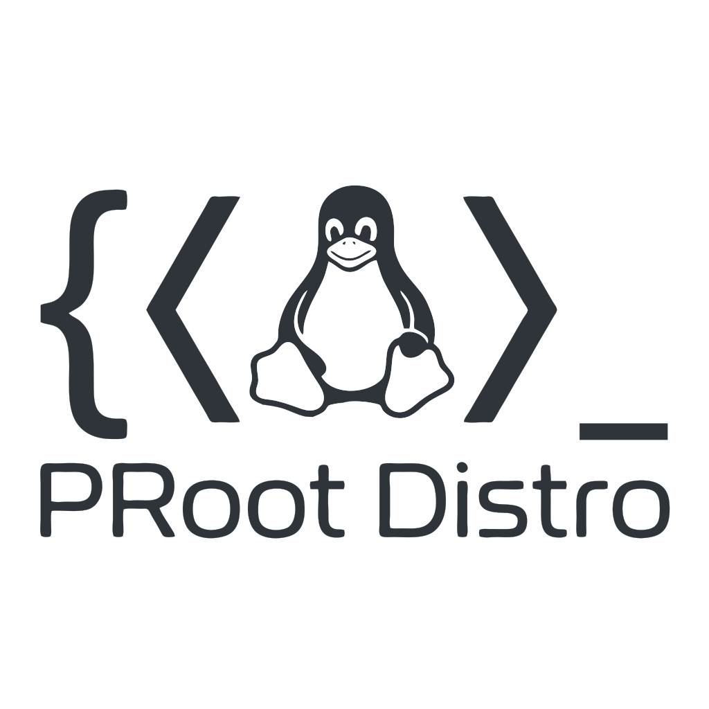

# proot-distro

  

**Linux on Android without root or Termux** — run Debian, Ubuntu, Alpine and any Docker/OCI image on your phone. A [Flet](https://flet.dev) app wrapping [proot-distro](https://github.com/termux/proot-distro) (PRoot containers), with a native xterm-style terminal.

> **Status:** M3 shipped (app scaffold + distro manager; terminal sessions land in M4) · milestones tracked in `docs/roadmap.md`.

## Start here
- [docs/roadmap.md](docs/roadmap.md) — milestones M1–M6 (the device-spike era is closed — D-016)
- [docs/reference/README.md](docs/reference/README.md) — the verified context library (read this to resume cold)
- [docs/decisions.md](docs/decisions.md) — decision log + open questions
- [docs/testing-findings.md](docs/testing-findings.md) — how this app gets tested
- [docs/requests/proot-mobile-forge-request.md](docs/requests/proot-mobile-forge-request.md) — native-wheel request record (flet-dev/flet discussions #6979)
